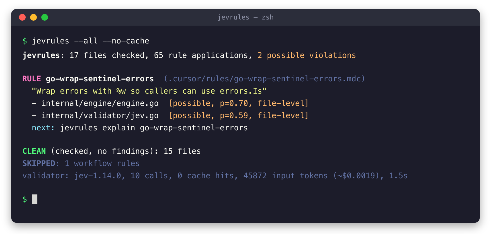

# jevrules

[](https://github.com/chrisDeFouRire/jevRules/actions/workflows/ci.yml)
[](https://github.com/chrisDeFouRire/jevRules/releases/latest)
[](LICENSE)

Check your code against Cursor's `.cursor/rules` from Claude Code, Codex, a git hook or CI.

Cursor applies the conventions in `.cursor/rules` on its own. Other agents never read those files, so they break the conventions without noticing. `jevrules` reads the same rule files, unchanged, works out which rules apply to which files, and asks [JEV](https://docs.typesafe.ai) (TypeSafe AI's System One model) whether each file follows them. The report is written for an agent to act on: the rule, the file, a probability, and the next command to run.

Treat the findings as leads, not verdicts. JEV gives a probability, and it is sometimes wrong.



*jevrules run on its own repository, which has its own [`.cursor/rules`](.cursor/rules).*

```
$ jevrules
jevrules: 2 files checked, 18 rule applications, 3 possible violations

The findings are possible errors only. For each finding, the validator examined
…

RULE java-no-fully-qualified-names  (backend/.cursor/rules/java-no-fully-qualified-names.mdc)
  "Avoid fully-qualified class names in Java code; add an import instead"
  - backend/module-billing/src/main/java/com/example/module/billing/BillingSearchParams.java  [likely, p=0.91, file-level]
  next: jevrules explain java-no-fully-qualified-names
```

## Install

Download a binary from the [latest release](https://github.com/chrisDeFouRire/jevRules/releases/latest). There are builds for macOS on Apple silicon and for Linux on amd64.

```bash
# macOS (Apple silicon)
curl -sL https://github.com/chrisDeFouRire/jevRules/releases/latest/download/jevrules_darwin_arm64.tar.gz | tar xz jevrules
sudo mv jevrules /usr/local/bin/

# Linux (amd64)
curl -sL https://github.com/chrisDeFouRire/jevRules/releases/latest/download/jevrules_linux_amd64.tar.gz | tar xz jevrules
sudo mv jevrules /usr/local/bin/
```

Each release includes `checksums.txt`. Check the install with `jevrules version`.

With Go 1.27+:

```bash
go install github.com/chrisDeFouRire/jevRules/cmd/jevrules@latest
```

## Quick start

1. Get a JEV API key from [console.typesafe.ai](https://console.typesafe.ai) and save it in `~/.config/jevrules/credentials`:

   ```bash
   mkdir -p ~/.config/jevrules
   printf 'TYPESAFE_API_KEY=%s\n' 'your-key' > ~/.config/jevrules/credentials
   chmod 600 ~/.config/jevrules/credentials
   ```

   See [API key](#api-key) for the other ways to provide it.

2. From your workspace root (the directory above the projects that hold `.cursor/rules`), see what would be checked:

   ```bash
   jevrules rules            # discovered rules, their globs and kind
   jevrules --plan           # which rules apply to your uncommitted changes (no API call)
   ```

3. Run it:

   ```bash
   jevrules                  # check uncommitted changes
   ```

## Usage

```bash
jevrules                              # uncommitted changes (staged + unstaged + untracked)
jevrules --staged --fail-on likely    # pre-commit hook
jevrules --since origin/main...HEAD   # a branch, in CI
jevrules --all                        # every tracked file that matches a rule
jevrules path/to/File.java src/       # explicit files / directories
jevrules --plan --estimate --all      # requests and tokens a run would cost
jevrules explain <rule-id>            # a rule's text (use scope/rule-id when ids collide)
jevrules dismiss <rule-id> <file> --reason "…"   # a finding examined and rejected
jevrules --precision high             # also pinpoint the offending lines (more calls)
jevrules --format json --out report.json   # schema: jevrules.schema.json
```

| Flag group | Flags |
|---|---|
| Targets (union) | `--changed` (default) `--staged` `--since <ref>` `--all` `<paths…>` |
| Rules | `--rule <id>` `--exclude-rule <id>` `--scope <dir>` `--include-unscoped` |
| Output | `--format text\|json` `--out <file>` `--fail-on none\|possible\|likely` `--quiet` |
| Validator | `--validator jev\|mock\|none` `--model <id>` `--no-cache` `--jobs N` `--precision none\|low\|normal\|high` `--whole-file` `--budget-tokens N` |
| Other | `--root <dir>` `--config <file>` |

Exit codes: `0` ok, `1` findings at or above `--fail-on` (default `none`), `2` usage or config error, `3` JEV unavailable or the key is missing or invalid.

`--plan`, `rules` and `explain` need no key, and neither does a fully cached run.

## Use with agents and hooks

Add this to the workspace `AGENTS.md` (Codex) and point to it from `CLAUDE.md`:

```markdown
## Conventions check

Before finishing a task, run `jevrules --changed` from the workspace root and settle every finding it reports.
```

The report itself tells the agent what to do with findings: they are candidates to confirm or dismiss, and the agent picks how to check each rule (searching, reading the code, or rerunning jevrules with `--precision`).

A rejected finding can be recorded with `jevrules dismiss <rule> <file> --reason "…"`. The entry goes in `.jevrules-dismissed.json` at the root; commit it. Later runs list the finding under `DISMISSED` instead of reporting it, until the file or the rule changes. Then the finding comes back with the earlier reason attached.

Git `pre-commit` hook (in each repo):

```sh
#!/bin/sh
cd "$(git rev-parse --show-toplevel)/.." && exec jevrules --staged --fail-on likely --quiet
```

## How it works

1. **Rules.** Every `**/.cursor/rules/**/*.{mdc,md}` under the root. A rule applies only under its *scope root* (the directory containing `.cursor/`). Globs are anchored to that root, as in Cursor: `*.ts` is root-level only, `**/*.ts` is any depth. All the `globs:` spellings found in the wild are accepted (quoted, comma-separated, `"a","b"`, `{html,ts}`).
2. **Kinds.** A rule with globs is a `code` rule. An `alwaysApply` rule *without* globs is a `workflow` rule: it tells the agent how to work, so it is never sent to JEV. A rule with neither is `manual`. `.jevrules.yml` can override any of this.
3. **One request per file.** Each applicable rule becomes one yes/no question about the file. Large files are split into windows to fit JEV's 32k per-question context.
4. **Drill-down** (opt-in). By default findings are file-level and cost exactly one call per file. `--precision low|normal|high` re-asks flagged rules over 120-line windows, then ≤20-line windows, then picks the exact lines.
5. **Diff scoping.** With `--changed/--staged/--since` and drill-down on, changed hunks ±10 lines are checked first; a violation found only elsewhere is marked `preexisting`. `--whole-file` turns this off.
6. **Cache.** `<root>/.jevrules-cache/` (git-ignores itself), keyed by file content, question (including the rule body) and model. Unchanged files cost nothing on re-runs.

Requests run 4 at a time (`--jobs`). Rate-limit and network errors are retried with backoff; after 3 consecutive requests exhaust their retries the run aborts with exit 3. `--budget-tokens N` stops cleanly and lists the files left unchecked.

## API key

jevrules looks for the JEV key in this order and uses the first one found:

1. The `TYPESAFE_API_KEY` environment variable, or `JEV_API_KEY`. Use this in CI, where the key comes from a secret.
2. `~/.config/jevrules/credentials`. Use this on your own machine. If `$XDG_CONFIG_HOME` is set, the file is `$XDG_CONFIG_HOME/jevrules/credentials` instead.

The credentials file holds either the bare key or a `TYPESAFE_API_KEY=…` or `JEV_API_KEY=…` line. `export`, quotes and `#` comments are fine, so you can paste the line from a `.env` file. jevrules doesn't read `.env` files itself. Run `chmod 600` on the file so only you can read it.

Don't put the key in `.jevrules.yml`: that file gets committed. jevrules never writes the key to reports, the cache or logs.

## Configuration

You don't need a config file. To tune things, add `<root>/.jevrules.yml` (or pass `--config`). [examples/jevrules.yml](examples/jevrules.yml) is a commented example for a `backend/` + `frontend/` workspace that:

- gives globs to `alwaysApply` rules that actually constrain code, so they get checked,
- adds regex `patterns` as prefilters, so JEV is only asked when a file could plausibly break the rule,
- sets thresholds, excludes and defaults.

The default model is pinned to `jev-1.14.0`. The `jev-latest` alias moves with each release, which would shift the probabilities and throw away the cache. Change it with `--model` or in the config.

## Documentation

- [docs/spec.md](docs/spec.md): the design spec (the problem, JEV's constraints, rule selection, the report format)
- [docs/development.md](docs/development.md): building, testing, releasing, and where the code departs from the spec
- [jevrules.schema.json](jevrules.schema.json): the JSON report schema

## License

[MIT](LICENSE)
